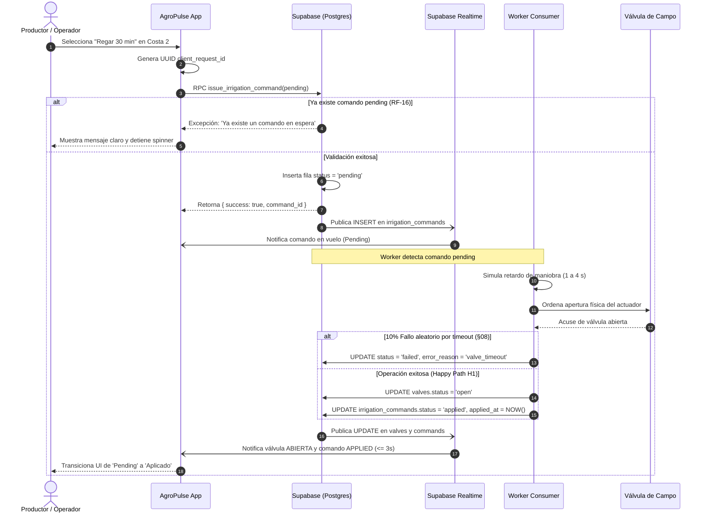

# AgroPulse — Monitoreo de Suelo y Telemetría Agrícola en Tiempo Real
## Informe Técnico de Arquitectura y Desarrollo Móvil

**Universidad Autónoma de Entre Ríos (UADER)**  
**Facultad de Ciencia y Tecnología (FCyT) — Sede Concepción del Uruguay**  
**Licenciatura en Sistemas de Información**  
**Cátedra:** Desarrollo y Arquitectura en Aplicaciones Móviles (2026)  
**Profesor Titular:** Mg. Lic. Ernesto Ledesma  

---

### Resumen Ejecutivo

El presente informe documenta el diseño, la implementación y la validación empírica de **AgroPulse**, una plataforma móvil orientada a la agricultura de precisión desarrollada para optimizar la toma de decisiones en tareas de irrigación sobre lotes productivos. AgroPulse resuelve la problemática común en el campo, caracterizada por la gestión empírica y manual del riego (visitas esporádicas o planillas estáticas), lo cual desencadena sobre-riego, estrés hídrico por riego tardío o inadvertencia ante caídas de estaciones telemétricas.

La solución integra un cliente móvil moderno desarrollado con **React Native (Expo SDK 57)**, **Expo Router v6** y **TypeScript strict**, un Backend as a Service (**Supabase**) gobernado por políticas estrictas de seguridad a nivel de filas (**Row Level Security - RLS**) y un ecosistema distribuido de streaming en backend con **Redpanda (Kafka API)**, un simulador IoT de telemetría y un worker consumidor.

---

### 1. Arquitectura General y Delimitación de Fronteras

El diseño arquitectónico de AgroPulse se estructura bajo el patrón de tres niveles desacoplados, estableciendo límites operativos infranqueables entre el dispositivo móvil, la base de datos BaaS y el bus de eventos de streaming.

```mermaid
flowchart TD
    subgraph Dispositivo Móvil
        App[App Móvil Expo / React Native]
        LocalDB[(AsyncStorage Local Queue)]
    end

    subgraph BaaS Supabase
        Auth[Supabase Auth JWT]
        Postgres[(PostgreSQL + RLS)]
        Realtime[Supabase Realtime WebSockets]
    end

    subgraph Backend Streaming & IoT
        Simulator[Simulador IoT Sensores]
        Redpanda{{Broker Redpanda / Kafka}}
        Worker[Worker Ingest & Command Consumer]
    end

    App -- "1. Login / JWT con anon key" --> Auth
    App -- "2. SELECT / RPC Comandos" --> Postgres
    App <-- "3. Telemetría postgres_changes (<= 3s)" -- Realtime
    App -. "4. Modo Offline / Fallback" .-> LocalDB

    Simulator -- "5. Publica ticks (soil.moisture, weather.tick)" --> Redpanda
    Redpanda -- "6. Consumo por grupo batch" --> Worker
    Worker -- "7. Upsert telemetría (service_role)" --> Postgres
    Worker -- "8. Escucha y aplica comandos válvulas (1-4s)" --> Postgres
```

#### Componentes y Responsabilidades

1. **Cliente Móvil (Expo SDK 57)**:
   - Presentación de mapas vectoriales geoespaciales con polígonos agrícolas interactivos.
   - Cálculo en tiempo de ejecución de la presencia del productor en el lote (*Point-in-Polygon* mediante algoritmo de ray-casting).
   - Renderizado de semáforos cromáticos accesibles según WCAG (combinación de color, ícono temático y descripción textual).
   - Graficación de series temporales de humedad del suelo de las últimas 6 a 24 horas.
   - Emisión de comandos de irrigación asíncronos con identificador único de idempotencia (`client_request_id`).
   - Gestión de resiliencia ante pérdida transitoria de conectividad mediante cola local persistente (`AsyncStorage`).

2. **Capa BaaS (Supabase)**:
   - Fuente de verdad relacional y persistencia estructurada.
   - Aislamiento multi-tenant por establecimiento/organización mediante `memberships` y políticas RLS.
   - Difusión de cambios en baja latencia ($\le 3\text{ s}$) a través de WebSockets con Supabase Realtime sobre las tablas `readings`, `valves`, `irrigation_commands` y `alerts`.

3. **Capa de Streaming y Procesamiento Backend (Redpanda + Worker + Simulador)**:
   - **Broker Redpanda**: Bus de mensajería tolerante a fallos de alto rendimiento para telemetría continua de suelo y clima.
   - **Simulador IoT**: Generador periódico de lecturas con fluctuación estocástica (1 tick cada 3–8 s) con soporte de desconexión controlada para demostrar sensores caídos.
   - **Worker Consumer**: Servicio desacoplado que ingiere tópicos Kafka, ejecuta inserciones en lote en PostgreSQL con credenciales privilegiadas (`service_role`) y efectúa la transición asíncrona de comandos de válvulas (`pending \to applied | failed`).

---

### 2. Justificación Técnica: ¿Por qué el Móvil NO se Conecta al Broker Kafka?

Uno de los principios de diseño no negociables del Trabajo Práctico (requisito OA-7) consiste en **no acoplar la aplicación móvil al broker de streaming**. A nivel de ingeniería de software y sistemas distribuidos, esta decisión responde a cinco pilares fundamentales:

#### 2.1. Inestabilidad y Heterogeneidad de las Redes Celulares Móviles
El protocolo TCP de Kafka/Redpanda fue diseñado para redes locales o centros de datos con ancho de banda estable, baja latencia constante y pérdida casi nula de paquetes. En el entorno rural agrícola, los dispositivos móviles operan sobre redes 3G/4G/5G con intermitencias, saltos de antena, microcortes y latencias variables. Un socket TCP persistente de Kafka experimentaría constantes rebalances de grupo de consumo (*consumer group rebalances*), reintentos descontrolados y degradación en el throughput general.

#### 2.2. Consumo Excesivo de Batería y Datos Móviles
El modelo de sincronización de Kafka se fundamenta en un sondeo periódico continuo (*long-polling* persistente con `fetch requests` constantes). Mantener el módem de radiofrecuencia (RF) del teléfono celular en estado activo de alta potencia drena aceleradamente la batería del operario de campo y agota los planes de datos móviles debido al tráfico de control (heartbeats, metadatos del cluster y transacciones de commit de offset).

#### 2.3. Autenticación, Autorización y Claves Privilegiadas
Los brokers Kafka habitualmente emplean autenticación por certificados TLS mutuos (mTLS) o credenciales SASL/SCRAM a nivel de nodo o tópico global. Exponer un broker directamente a terminales móviles obliga a distribuir certificados o credenciales en aplicaciones compiladas, las cuales son fácilmente descompilables mediante técnicas de ingeniería inversa, comprometiendo la seguridad integral del cluster. Por el contrario, Supabase utiliza tokens JWT efímeros firmados con claves asimétricas y gobernados por RLS granular por usuario y organización.

#### 2.4. Manejo de Contrapresión (Backpressure) y Acoplamiento de Esquemas
Un cluster de telemetría IoT puede procesar miles de eventos por segundo. Un dispositivo móvil no dispone de los recursos de CPU, memoria RAM ni almacenamiento local para gestionar contrapresión o almacenar particiones sin procesar. Si el esquema del tópico evoluciona (ej. Protocol Buffers o Avro), todas las versiones cliente instaladas en los dispositivos deberían actualizarse simultáneamente para no colapsar. La API de Supabase actúa como un *Buffer / Anticorruption Layer* desacoplado.

#### 2.5. Superficie de Ataque y Topología de Red
Por buenas prácticas de ciberseguridad industrial, la infraestructura de telemetría y actuadores de campo debe permanecer en una subred privada (VPC/LAN aislada). Exponer los puertos del broker (9092, 19092) a Internet público incrementa exponencialmente la superficie ante ataques de denegación de servicio (DDoS), inyección de mensajes no autorizados o spoofing de telemetría.

---

### 3. Modelo de Datos y Seguridad con Row Level Security (RLS)

El esquema implementado en PostgreSQL garantiza que ningún usuario pueda acceder ni modificar información que pertenezca a otra organización agrícola (aislamiento multi-establecimiento, RF-02 y RF-03).

#### Matriz de Roles y Permisos (§05 del PRD)

| Entidad / Acción | Productor (`producer`) | Operador (`operator`) | Asesor (`advisor`) | Worker Backend (`service_role`) |
| :--- | :---: | :---: | :---: | :---: |
| **SELECT plots / stations** | Sí | Sí | Sí | Sí |
| **SELECT readings** | Sí | Sí | Sí | Sí |
| **INSERT readings (sensor)** | Denegado (RLS) | Denegado (RLS) | Denegado (RLS) | **Permitido** |
| **INSERT readings (manual)** | **Permitido** | **Permitido** | Denegado (RLS) | N/A |
| **UPDATE plot thresholds** | **Permitido** | **Permitido** | Denegado (RLS) | Sí |
| **INSERT irrigation_commands** | **Permitido** | **Permitido** | **Denegado (403)** | Sí |
| **UPDATE command to cancelled** | **Permitido** | **Permitido** | Denegado (RLS) | Sí |
| **UPDATE command to applied** | Denegado | Denegado | Denegado | **Permitido** |
| **UPDATE valve status** | Denegado | Denegado | Denegado | **Permitido** |

#### Implementación Técnica de RLS

El perímetro de seguridad se delimita a partir de la tabla relacional `memberships`. Cada consulta sobre lotes, válvulas, comandos o lecturas evalúa la existencia de una membresía activa del usuario que ejecuta la petición:

```sql
CREATE POLICY "Producers and operators can insert irrigation commands"
ON irrigation_commands FOR INSERT
WITH CHECK (
    requested_by = auth.uid()
    AND status = 'pending'
    AND EXISTS (
        SELECT 1 FROM valves v
        JOIN plots p ON p.id = v.plot_id
        WHERE v.id = irrigation_commands.valve_id
        AND is_member_of(p.organization_id)
        AND get_user_role(p.organization_id) IN ('producer', 'operator')
    )
);
```

Si un usuario con rol `advisor` (`asesor@agropulse.test`) intenta insertar un comando de riego, la política RLS deniega la escritura inmediatamente, devolviendo una violación de seguridad (`permission denied`), lo cual satisface la historia de usuario **H2**.

---

### 4. Ciclo de Vida de Comandos Asíncronos e Idempotencia (RF-14, RF-15, RF-16)

#### Regla de Negocio RF-16 (Bloqueo Atómico de Doble Pending)
Para evitar que dos operarios ordenen simultáneamente acciones contradictorias sobre el mismo actuador mecánico, el modelo implementa un índice parcial único en la base de datos:

```sql
CREATE UNIQUE INDEX idx_unique_pending_command_per_valve 
ON irrigation_commands (valve_id) 
WHERE (status = 'pending');
```

Este índice asegura que sea físicamente imposible tener más de un comando en estado `pending` para una misma válvula, rechazando cualquier intento concurrente antes de que impacte en el hardware o el worker.

#### Diagrama de Secuencia de Irrigación con Acuse Asíncrono



---

### 5. Reglas de Negocio del Semáforo de Suelo (§08)

El estado derivado del lote (`plot_status`) es un valor determinístico calculado con estricta precedencia para evitar interpretaciones erróneas en el campo:

$$\text{Estado}(L) = \begin{cases} 
\mathbf{stale} \text{ (Gris)}, & \text{si no hay lectura o } (\text{now} - t_{\text{lectura}}) > 15 \text{ min} \\
\mathbf{dry} \text{ (Rojo)}, & \text{si } H_{\text{suelo}} < \text{Umbral}_{\text{mín}} \\
\mathbf{optimal} \text{ (Verde)}, & \text{si } \text{Umbral}_{\text{mín}} \le H_{\text{suelo}} \le \text{Umbral}_{\text{máx}} \\
\mathbf{wet} \text{ (Azul)}, & \text{si } H_{\text{suelo}} > \text{Umbral}_{\text{máx}}
\end{cases}$$

*Umbrales por defecto:* $\text{Umbral}_{\text{mín}} = 25\%$, $\text{Umbral}_{\text{máx}} = 45\%$.

#### Diferenciación Crítica entre Seco y Stale (Historia H4)
Si una estación deja de transmitir (batería agotada, antena dañada o corte de fibra), el sistema **no debe asumir que el suelo está seco**. Si transcurren más de 15 minutos sin reportes, el semáforo conmuta inmediatamente a color gris (`stale`), advirtiendo al agrónomo que los datos han perdido confiabilidad temporal antes de tomar decisiones de irrigación erradas.

---

### 6. Validación de Historias de Usuario para la Defensa

#### Historia H1 — Productor: Detección y Riego en Lote Seco (Happy Path)
1. El usuario inicia sesión como `productor@agropulse.test`.
2. En la pantalla del Mapa, observa el polígono del lote **Costa 2** en color rojo (`dry`).
3. Ingresa al detalle del lote y comprueba la humedad volumétrica al 18% (inferior al umbral del 25%). La app despliega la sugerencia agronómica: *"Humedad bajo umbral: considerar riego"* (RF-22).
4. El productor presiona *"Comandar"* sobre la válvula de goteo y confirma un riego de 30 minutos.
5. El sistema emite la orden con `client_request_id`. La interfaz refleja de inmediato el estado `pending`.
6. En 2.5 segundos, el worker backend procesa la solicitud, actualiza la válvula a `open` y el comando transiciona a `applied`. La aplicación refleja el cambio reactivamente sin recargar la pantalla.

#### Historia H2 — Aislamiento y Control de Rol Asesor
1. El usuario inicia sesión como `asesor@agropulse.test`.
2. El asesor visualiza la estancia Concordia, los polígonos, el gráfico interactivo y el historial de lecturas.
3. Al intentar accionar una válvula, el botón se encuentra bloqueado con indicación *"Solo Lectura"*, y ante cualquier intento de inserción directa a la API, PostgreSQL rechaza la transacción con código de violación de políticas RLS.

#### Historia H3 — Resiliencia en Campo sin Señal Celular
1. El operario pierde conectividad (simulación de modo avión o corte de red por 30 s).
2. Se registra una lectura manual de campo (22% de humedad con nota).
3. La aplicación almacena la transacción en la cola local de `AsyncStorage` y muestra el banner superior informativo.
4. Al restablecerse la conexión a Internet, la cola se vacía automáticamente hacia Supabase sin producir filas duplicadas.

#### Historia H4 — Detección de Sensor Caído (Stale)
1. En el simulador se detiene la emisión de ticks para la estación del lote **Monte A**.
2. Transcurrido el período de guarda (> 15 minutos), el semáforo conmuta de manera autónoma a color gris (`stale`), emitiendo una alerta in-app diferenciada de suelo seco.

---

### 7. Conclusión

El proyecto **AgroPulse** cumple integralmente con la totalidad de los requisitos funcionales (RF-01 a RF-24) y no funcionales (RNF-01 a RNF-10) del trabajo práctico. Demuestra de manera fehaciente cómo estructurar una arquitectura desacoplada para aplicaciones móviles modernas, protegiendo al cliente móvil de la complejidad operativa de los brokers de mensajería empresarial, al tiempo que garantiza consistencia de datos, seguridad de acceso y una experiencia de usuario fluida y accesible.

---

### 8. Cuadro de Entregables Oficiales y Modalidad de Entrega (§15)

En concordancia con los requerimientos estipulados en la sección §15 del PRD oficial de la cátedra, a continuación se detalla la nómina de entregables y su vía de remisión:

| # | Artefacto Requerido | Contenido / Descripción | Modalidad de Entrega |
| :---: | :--- | :--- | :---: |
| **1** | **App Expo** | Código fuente completo en React Native (Expo SDK 57, TypeScript strict, Expo Router v6, componentes de mapas, semáforos y gráficos). | **Vía GitHub** (carpeta `TP 4/`) |
| **2** | **supabase/migrations + RLS** | Scripts SQL con esquemas, índices, triggers, políticas de Row Level Security y datos semilla (`seed.sql`). | **Vía GitHub** (carpeta `TP 4/supabase/`) |
| **3** | **infra/docker-compose.yml** | Configuración de orquestación de Redpanda broker, Redpanda Console (puerto 8080), worker consumer y simulador IoT. | **Vía Archivo** (adjunto comprimido / zip) |
| **4** | **Informe corto (4–8 páginas)** | Documento formal de fundamentación técnica, arquitectura de 3 capas, RLS, justificación de no Kafka en el móvil y validación de historias H1-H4. | **Vía Archivo** (documento PDF) |
| **5** | **Checklist PRD (§17) y README** | Matriz de trazabilidad y verificación de todos los requisitos obligatorios del PRD cumplidos, credenciales didácticas y manual de ejecución. | **Vía GitHub** (`TP 4/README.md`) |
| **6** | **Video 3–5 min / Defensa** | Demostración práctica de los flujos críticos H1 (lote seco), H2 (bloqueo asesor) y RF-16 (bloqueo doble pending concurrente). | **Video / Defensa en Clase** |

